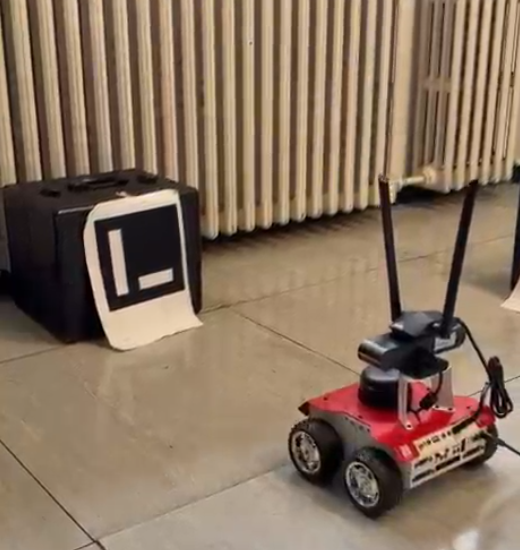
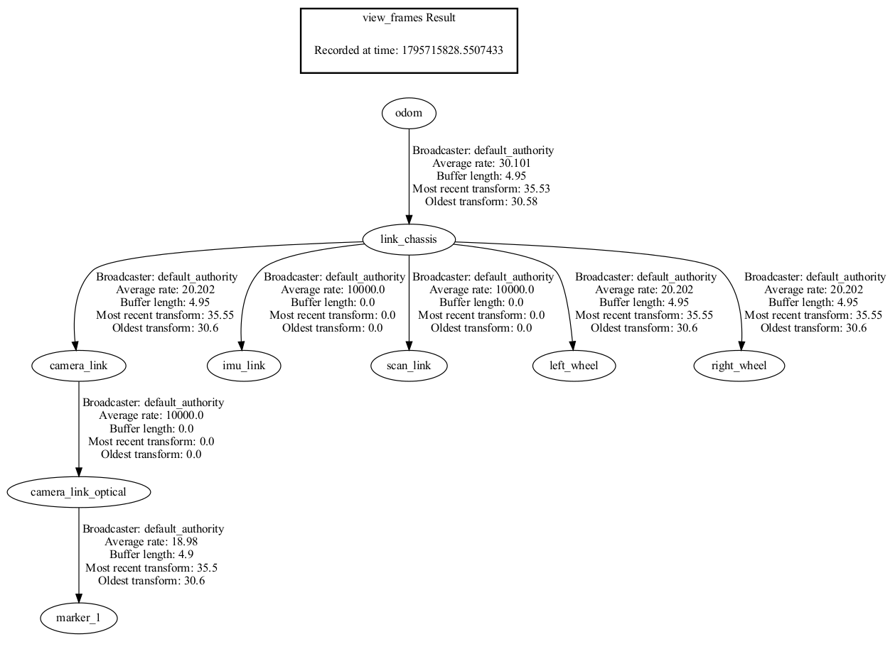
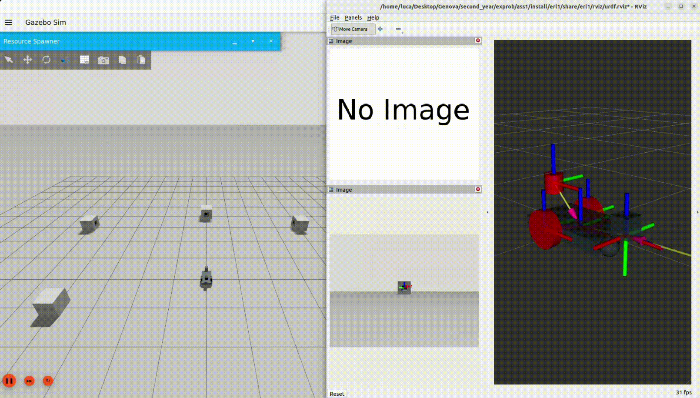

# ERL Assignment 1 — ArUco Treasure Hunt

<p align="center">
  <b>ROS2 Jazzy · C++ · ArUco · OpenCV · Gazebo · ROSbot</b>
</p>

<p align="center">
  
  
  
  
</p>

---

This project implements a ROS2 vision-based treasure hunt for a mobile robot, both in a Gazebo/RViz simulation and on a real ROSbot.
The robot explores the environment looking for ArUco markers, which must be found in order (ID 1 → 2 → 3 → 4).

Each marker tells the robot where to go next: when a marker is reached, the robot circles it in the camera image, turns in the direction associated with its ID and starts looking for the next one.
When the marker with ID 4 is reached, the treasure is found and the robot stops.

| Feature | Implementation |
|---|---|
| Marker detection | `aruco_opencv` with the `ARUCO_ORIGINAL` dictionary |
| Marker sequence | ID 1 → 2 → 3 → 4 |
| Approach and alignment | Apparent marker size and horizontal image offset |
| Turning | Odometry-based yaw control |
| Annotated camera output | Green circle and marker ID |
| Execution | Gazebo/RViz simulation and physical ROSbot |

<div align="center">
  
</div>

---

## Table of Contents

| Section | Description |
|---|---|
| [1. CUSTOM COMMUNICATION INTERFACES](#1-custom-communication-interfaces) | Custom ROS messages |
| [2. ARCHITECTURE AND NODES](#2-architecture-and-nodes) | Packages and node behavior |
| [3. NODES PARAMETERS](#3-nodes-parameters) | Simulation and hardware settings |
| [4. ARUCO TRACKER CONFIGURATION](#4-aruco-tracker-configuration) | ArUco detection settings |
| [5. LAUNCH FILES](#5-launch-files) | Simulation and hardware launch files |
| [6. REAL ROBOT: ID TOPIC](#6-real-robot-id-topic) | Marker IDs on the ROSbot |
| [7. TF2 FRAME STRUCTURE](#7-tf2-frame-structure) | Coordinate frames |
| [8. HOW TO RUN THE SIMULATION](#8-how-to-run-the-simulation) | Gazebo and RViz commands |
| [9. HOW TO RUN ON THE REAL ROBOT](#9-how-to-run-on-the-real-robot) | ROSbot commands |

---

# 1. CUSTOM COMMUNICATION INTERFACES

The two custom messages used by the nodes are in the dedicated package `robot_interfaces`:

| Message | Field | Type | Description |
|---|---|---|---|
| `ErrorsMsg` | `side_err` | `std_msgs/Float64` | Difference between the desired marker side in pixels and the measured one (`sd - s`) |
| `ErrorsMsg` | `misalignment_err` | `std_msgs/Float64` | Horizontal pixel offset between the marker center and the image center (`u - cx`) |
| `MarkerImage` | `id` | `int32` | ID of the marker that has just been reached |
| `MarkerImage` | `circle_image` | `sensor_msgs/Image` | Camera frame with the circle and the ID drawn around the marker |

---

# 2. ARCHITECTURE AND NODES

The system is split in two packages plus the third-party `aruco_opencv` detector:

```bash
erl1/                       # simulation + hardware support package
├── config
│   ├── ekf.yaml            # robot_localization EKF configuration
│   ├── sim_params.yaml     # parameters of the nodes (simulation)
│   └── robot_params.yaml   # parameters of the nodes (real robot)
├── launch
│   ├── world.launch.py
│   ├── spawn_assignment.launch.py        # simulation
│   └── spawn_assignment_real.launch.py   # real robot
├── rviz
├── urdf
└── worlds                  # assignment.sdf

robot_controller/
├── CMakeLists.txt
├── package.xml
└── src
    ├── perception_node.cpp
    └── robot_motion.cpp

robot_interfaces/
└── msg
    ├── ErrorsMsg.msg
    └── MarkerImage.msg
```

### **Source Files** - `robot_controller/src/`

  - **1) `perception_node.cpp` - `PerceptionNode`**<br>
    It is the node that interprets the camera and the ArUco detections. This node:
    - subscribes to `/aruco_detections` (QoS: keep last 1, best effort) and looks for the marker whose ID is the next one to reach (`id_to_reach`, starting from 1);
    - keeps a copy of the latest camera frame, used to draw on the image;
    - from the marker pose (x, y, z in the camera frame) computes the **apparent side in pixels** <br>`s = fx * L / z` (with `L` = real marker side) and the pixel coordinates of the marker center <br>`u = fx·x/z + cx`, `v = fy·y/z + cy`;
    - publishes on `/errors_topic` the two errors used by the controller:
      - `side_err = sd - s` — how far the robot is from the marker (`sd` = target side in pixels);
      - `misalignment_err = u - cx` — how much the marker is off-center;
      - if the marker is **not visible**: `side_err = -10`, `misalignment_err = 0` (this is the signal for "searching");
    - when `side_err <= 1` (marker close enough) it **draws a circle and the label `id N`** on the camera frame, publishes the image on `/circle_pub_topic`, publishes a `MarkerImage` message on `/marker_image` and increments `id_to_reach`;
    - a `flag` makes the check re-arm only once the robot has moved away again (`side_err > 1`), so the same marker is not counted twice.

  - **2) `robot_motion.cpp` - `RobotMotion`**<br>
    It is the node that drives the robot through a 3-state machine, executed by a 100 ms timer. It publishes `geometry_msgs/Twist` on `/cmd_vel` and uses `/odom` to read the robot yaw. The states are:

| State | Behaviour | Transition |
|---|---|---|
| `APPROACH` | If the marker is far (`side_err > 1`): proportional control, `v = k_v · side_err`, `ω = -k_w · misalignment_err`. If the marker is reached (`\|side_err\| < 1`): stop. If the marker is not visible: move forward to **search**. The current yaw is stored as `initial_yaw`. | A `MarkerImage` message arrives → `TURN` (or `TREASUREFOUND` if ID = 4) |
| `TURN` | Rotates in place with `ω = k_a · angular_error`. The target yaw is `initial_yaw + delta`, where `delta` depends on the marker ID (see table below). | `\|angular_error\| < 0.05 rad` → `APPROACH` |
| `TREASUREFOUND` | Stops the robot and logs `TREASURE FOUND`. | — |

Rotation associated with each marker (relative to the heading when the marker was reached):

<div align="center">

| Marker ID | Rotation `delta` |
|:---:|:---:|
| 1 | −90° (turn right) |
| 2 | 180° (turn around) |
| 3 | +90° (turn left) |
| 4 | — (treasure, stop) |

</div>

The angular error is always wrapped in [−π, π] with `atan2(sin(e), cos(e))`.

---

# 3. NODES PARAMETERS

All the topics and gains can be changed from the parameter YAML files (`sim_params.yaml` / `robot_params.yaml`) without recompiling.

| Node | Parameter | Simulation | Real robot | Description |
|---|---|---|---|---|
| `perception_node` | `marker_image_topic` | `/marker_image` | `/marker_image` | Topic of `MarkerImage` |
| | `circle_image_topic` | `/circle_pub_topic` | `/circle_pub_topic` | Topic of the image with the circle |
| | `errors_topic` | `/errors_topic` | `/errors_topic` | Topic of `ErrorsMsg` |
| | `aruco_detections_topic` | `/aruco_detections` | `/aruco_detections` | Detections from `aruco_opencv` |
| | `camera_info_topic` | `/camera/camera_info` | `/rosbot_3/camera/rgb/camera_info` | Camera intrinsics |
| | `camera_image_topic` | `/camera/image` | `/rosbot_3/camera/rgb/image_raw` | Raw camera image |
| | `marker_side` | `0.2` m | `0.2` m | Real side of the marker (`L`) |
| | `target_side_px` | `166` px | `116` px | Desired marker side in pixels (`sd`) |
| `robot_motion` | `cmd_vel_topic` | `/cmd_vel` | `/rosbot_3/cmd_vel` | Velocity command topic |
| | `odom_topic` | `/odom` | `/rosbot_3/odom` | Odometry topic |
| | `k_v` | `0.0015` | `0.002` | Linear gain (approach) |
| | `k_w` | `0.001` | `0.01` | Angular gain (centering on the marker) |
| | `k_a` | `0.3` | `0.3` | Angular gain (turning) |

---

# 4. ARUCO TRACKER CONFIGURATION

The marker detection is performed by `aruco_opencv` (`aruco_tracker_autostart`), configured with two files:

| | `aruco_tracker.yaml` (sim) | `aruco_tracker_real.yaml` (real) |
|---|---|---|
| `cam_base_topic` | `/camera/image` | `/rosbot_3/camera/rgb/image_raw` |
| `image_sub_compressed` | `false` | `true` |
| `cornerRefinementMethod` | `2` (Contour) | `1` (Subpix) |
| `marker_dict` | `ARUCO_ORIGINAL` | `ARUCO_ORIGINAL` |
| `marker_size` | `0.2` m | `0.2` m |

---

# 5. LAUNCH FILES

**1) Simulation → `spawn_assignment.launch.py`** starts:

- the Gazebo world (`assignment.sdf`) through `world.launch.py` and spawns the robot (`my_robot.urdf`) at (0, 0);
- RViz, `robot_state_publisher` and the **EKF** (`robot_localization`) for the odometry;
- the `ros_gz_bridge` (`/clock`, `/cmd_vel`, `/odom`, `/joint_states`, `/camera/camera_info`, `/camera_joint/cmd_pos`, `/imu`) and the `ros_gz_image` bridge for `/camera/image`;
- the `aruco_tracker`, the `perception_node` and the `robot_motion` node.

The `robot_motion` node is started with a 8 s delay, to wait for the simulation and the detector to be ready.

Launch arguments: `rviz` (default `true`), `world` (default `assignment.sdf`), `model` (default `my_robot.urdf`), `params_file` (default `sim_params.yaml`).

**2) Real robot → `spawn_assignment_real.launch.py`** starts only what runs on the PC (everything with `use_sim_time: False`):

- RViz, the `aruco_tracker` (with `aruco_tracker_real.yaml`), the `perception_node` and the `robot_motion` node (delayed by 5 s);
- no Gazebo, no bridges: camera, odometry and `/cmd_vel` come directly from the ROSbot.

Launch arguments: `rviz`, `model`, `params_file` (default `robot_params.yaml`).

---

# 6. REAL ROBOT: ID TOPIC

On the real robot the marker ID is also exchanged through a dedicated topic `/id_topic` (`std_msgs/Int32`). To enable it, uncomment the lines marked `DELETE COMMENT FOR REAL LIFE ROBOT` in:

- `perception_node.cpp` → publishes the ID on `/id_topic` when a marker is reached;
- `robot_motion.cpp` → subscribes to `/id_topic` (`id_callback`) and runs the same `TURN` / `TREASUREFOUND` logic as `marker_img_callback`.

---

# 7. TF2 FRAME STRUCTURE

<div align="center">
  
</div>

# 8. HOW TO RUN THE SIMULATION

<div align="center">
  
</div>

First, build the workspace:

```bash
colcon build
source install/setup.bash
```

Then launch everything with:

```bash
ros2 launch erl1 spawn_assignment.launch.py
```

This command will open:

- the **Gazebo** world with the robot;
- the **RViz** visualizer.

After 8 s the `robot_motion` node starts and the robot begins to search for marker 1. To follow the perception in RViz, add the image topic `/circle_pub_topic`: the marker reached is highlighted with a green circle and its ID.

---

# 9. HOW TO RUN ON THE REAL ROBOT

(video)

After connecting to the ROSbot (same `ROS_DOMAIN_ID`, camera topics visible with `ros2 topic list`):

```bash
colcon build
source install/setup.bash
ros2 launch erl1 spawn_assignment_real.launch.py
```

Before running, check that the camera topics in `aruco_tracker_real.yaml` and `robot_params.yaml` match the ones of your robot (`/rosbot_N/camera/rgb/...`), and that the lines for `/id_topic` have been uncommented.
